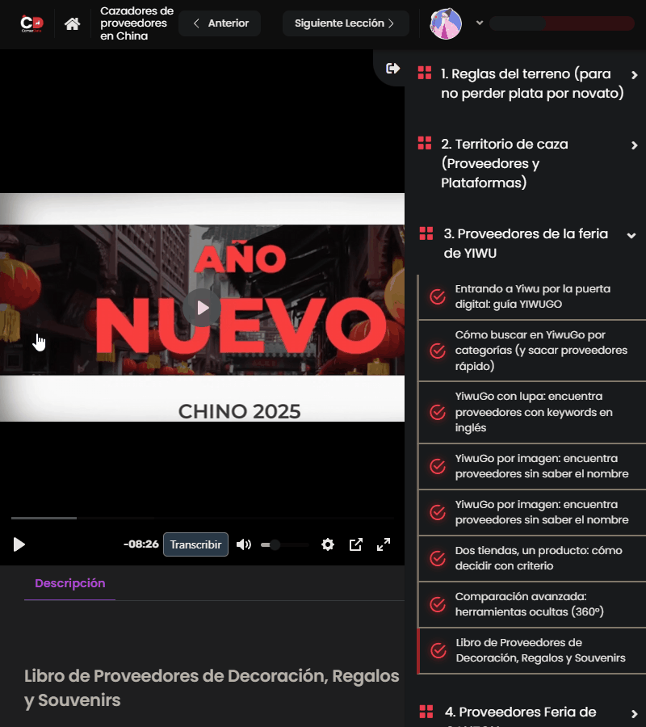

# Transcript para Comerdata

> Extensión de Brave para transcribir lecciones de Comerdata en Windows y reunirlas en un documento por curso.

El panel se abre junto al contador del video y muestra el avance de la transcripción. Puedes copiar el texto, guardar cada lección en su módulo y descargar una lección o el curso completo.

## Demostraciones

### Transcripción desde el reproductor

  

### Descarga de transcripciones

  

## Compatibilidad

La versión actual está configurada para las lecciones de **`academia.comerdata.com`** en **Brave para Windows**. Admite videos de hasta **15 minutos** con segmentos **HLS**, audio **AAC sin cifrar** y el reproductor y CDN configurados en la extensión. La pista de audio extraída admite hasta **32 MB**.

Otras academias con un reproductor similar requerirían adaptar el dominio, la lectura del audio y la detección de títulos. Los sitios con archivos directos, como MP3, M4A o MP4, requerirían un lector adicional. Para sitios cuyo audio solo se obtiene durante la reproducción, habría que implementar un modo de captura de pestaña. YouTube y Vimeo quedan fuera de la compatibilidad actual.

## Tecnologías

## Instalación y uso en Windows

1. Cierra cualquier ventana anterior de Transcript. Abre **Iniciar Transcript.cmd** y deja la ventana abierta cuando diga **Transcript listo**. Ese mensaje significa que el servicio está esperando una solicitud desde Brave.
2. Abre `brave://extensions` y pulsa **Recargar** en la tarjeta de Transcript. Para una primera instalación, activa **Modo desarrollador**, pulsa **Cargar descomprimida** y selecciona la carpeta que contiene `manifest.json`.
3. Recarga la pestaña de Comerdata. Busca **Transcribir** junto al contador del video. Si el reproductor usa otros controles, el botón aparece sobre el video, en la parte inferior derecha.
4. Abre el panel y pulsa **Transcribir lección**. Si el reproductor aún no cargó el audio, reproduce unos segundos y pon el video en pausa. El panel muestra el avance sin abrir otra pestaña.

## Reunir las lecciones de un curso

1. Revisa el campo **Título del video**. La extensión intenta tomarlo de la página de la lección y permite corregirlo antes o después de transcribir.
2. Cuando veas **Transcripción guardada en este curso**, pasa a la lección siguiente y repite. Volver a transcribir una lección actualiza su entrada. Cada curso tiene su propia colección.
3. En cualquier lección del curso, abre Transcript y pulsa **Curso en PDF**, **Curso en Markdown** o **Curso en Word**. El archivo agrupa las lecciones guardadas por módulo. Puedes corregir el nombre del módulo desde el panel si el sitio no lo muestra.

## Revisar y descargar Word

Transcript busca intervalos de 12 segundos o más sin palabras reconocidas, incluidos el inicio y el final. Si aparece un intervalo, pulsa su botón para escucharlo. Confirma la revisión si compruebas que no falta voz. Si detectas voz omitida, vuelve a transcribir y comprueba el resultado. La descarga del curso en Word espera a que estén revisadas todas las lecciones guardadas que tengan intervalos marcados.

Word conserva los encabezados de módulo y de video y presenta el texto sin marcas de tiempo. PDF y Markdown conservan los tiempos. Las transcripciones de versiones anteriores necesitan volver a procesarse una vez para disponer de esta comprobación en Word.

Las transcripciones guardadas permanecen en el perfil local de Brave aunque cierres el navegador. Si tienes texto de una versión anterior, puedes seguir usando los archivos que exportaste. Para añadirlo al archivo del curso desde Transcript, vuelve a transcribir esa lección.

En **Gestionar transcripciones guardadas**, puedes eliminar una lección o borrar todas las transcripciones del curso abierto. Ambas acciones piden confirmación.

## Cómo convierte el audio en texto

La extensión lee los segmentos HLS que el reproductor ya puede cargar con tu sesión y separa el audio AAC del video con [mux.js](https://github.com/videojs/mux.js). El servicio local decodifica el audio a mono de 16 kHz y lo pasa a [faster-whisper](https://github.com/SYSTRAN/faster-whisper). El modelo multilingüe Whisper Base se ejecuta en la CPU, detecta el idioma y devuelve el texto y sus marcas de tiempo.

La primera ejecución necesita Python 3.10 o posterior e instala las dependencias y el modelo que falten en `%LOCALAPPDATA%\ComerdataTranscript`. La transcripción se procesa en esta PC. Las descargas se guardan en la ubicación configurada en Brave.

La licencia Apache 2.0 de la biblioteca incluida se encuentra en [vendor/mux.js-LICENSE](vendor/mux.js-LICENSE).
